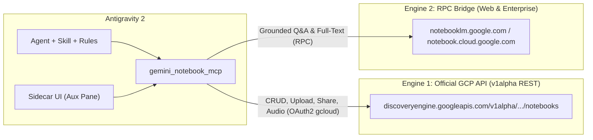

# 📓 agy-gemini-notebook-plugin

**Connect your Google Antigravity 2 conversations and workspaces to Gemini Notebooks (NotebookLM & NotebookLM Enterprise).**

In the Gemini web app, users can attach a **Gemini Notebook (NotebookLM)** to a conversation for grounded, source-backed context. **`agy-gemini-notebook-plugin`** brings first-class Gemini Notebook integration directly into **Google Antigravity 2** as a complete open-source plugin (MCP Server + Skill + Grounding Rules + Sidecar UI).

---

## ✨ Key Features

- 🔗 **Workspace Notebook Binding (`.agents/notebook.json`)**: Attach one or more Gemini Notebooks to a codebase so the Antigravity 2 agent automatically grounds its answers in your architecture specs, ADRs, PDFs, and research notes.
- 🏢 **Engine 1 — Official Google Cloud API (`v1alpha` Discovery Engine)**:
  - 100% official OAuth 2.0 authentication via `gcloud auth print-access-token` (no browser cookies required).
  - Create notebooks (`notebooks.create`), list recently viewed notebooks (`notebooks.listRecentlyViewed`), and manage team sharing (`notebooks.share`).
  - **Code $\rightarrow$ NotebookLM Sync (`notebook_sync_files`)**: Upload local `.md`, `.pdf`, `.txt`, `.docx`, `.pptx`, `.xlsx`, audio, and image files directly to a NotebookLM Enterprise notebook via `sources:uploadFile` and `sources:batchCreate`.
  - Generate on-demand podcast **Audio Overviews** via `audioOverviews.create`.
- 💬 **Engine 2 — RPC Bridge (Grounded Q&A & Consumer Accounts `notebooklm.google.com`)**:
  - Conversational RAG queries (`notebook_query`) with inline source citations.
  - Full-text source extraction (`notebook_get_source_text`).
  - Compatible with personal Google accounts (`notebooklm.google.com`) via `notebooklm-py`.
- 🖥️ **Antigravity 2 Sidecar UI Panel**: Interactive notebook selector and active source filter inside Antigravity 2's auxiliary side pane.

---

## 🏗️ Dual-Engine Architecture



---

## 🚀 Quick Start

### 1. Clone and install dependencies (via `uv`)

```bash
git clone https://github.com/Chryzalide/agy-gemini-notebook-plugin.git
cd agy-gemini-notebook-plugin
uv sync --all-extras
```

### 2. Enable the plugin in Antigravity 2

Create a symlink in your Antigravity 2 plugins directory:

```bash
mkdir -p ~/.gemini/config/plugins
ln -s "$(pwd)" ~/.gemini/config/plugins/gemini-notebook
```

### 3. Configure Authentication

#### Option A: NotebookLM Enterprise (Official Google Cloud `v1alpha` API)
Set your Google Cloud environment variables and authenticate via `gcloud`:

```bash
export GCP_PROJECT_NUMBER="123456789012"
export GCP_LOCATION="global"          # global, us, or eu
export GCP_ENDPOINT_LOCATION="global" # global, us, or eu

gcloud auth login
# Optional: enable Google Drive access when ingesting Google Docs / Slides:
gcloud auth login --enable-gdrive-access
```

#### Option B: Grounded Q&A & Personal Accounts (`notebooklm.google.com`)
Authenticate your `notebooklm-py` session:

```bash
uv run notebooklm login
```

---

## 🛠️ Exposed MCP Tools (`gemini_notebook_mcp`)

| MCP Tool | Engine | Description |
| :--- | :--- | :--- |
| `notebook_list` | REST `v1alpha` / RPC | List recently viewed notebooks |
| `notebook_get` | REST `v1alpha` | Retrieve metadata and source list for a notebook |
| `notebook_create` | REST `v1alpha` | Create a new Gemini Notebook |
| `notebook_attach` | Local (`.agents/notebook.json`) | Attach a notebook to the active Antigravity 2 workspace |
| `notebook_status` | Local + REST | Show the workspace-attached notebook and engine auth status |
| `notebook_sync_files` | REST `v1alpha` (`uploadFile`) | Upload local files (`.md`, `.pdf`, `.txt`, etc.) to a notebook |
| `notebook_add_source` | REST `v1alpha` (`batchCreate`) | Add a web URL, raw text, YouTube video, or Google Drive document |
| `notebook_create_audio` | REST `v1alpha` (`audioOverviews`) | Generate an Audio Overview podcast for the notebook |
| `notebook_query` | RPC Bridge | Ask a grounded RAG question against the notebook with citations |
| `notebook_get_source_text` | RPC Bridge | Fetch the full indexed text of a specific source |

---

## 📄 License

Distributed under the **MIT License**. Contributions are welcome!
