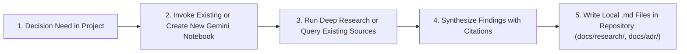

# 📓 agy-gemini-notebook-plugin


[](https://souryan-auge.fr/)

**Invoke and pilot Gemini Notebooks (NotebookLM & NotebookLM Enterprise) from Google Antigravity 2, VS Code, Cursor, Claude Code, and the CLI.**

In the Gemini web app, users can attach a **Gemini Notebook (NotebookLM)** to a conversation for grounded, source-backed context. **`agy-gemini-notebook-plugin`** brings first-class Gemini Notebook integration—plus **autonomous notebook piloting, Fast & Deep Research, and Studio Artifact generation**—directly into **Google Antigravity 2**, **VS Code**, and any MCP-compatible agent harness.

---

## ✨ Key Features

- 🎯 **Invoke Notebooks by ID, Alias, or Fuzzy Title (`notebook_invoke` & `notebook_query`)**:
  - Attach a default notebook (plus named aliases) to your repository via `.agents/notebook.json`.
  - Invoke any notebook on the fly by ID, workspace alias, or fuzzy title match—with optional one-step grounded Q&A and inline source citations.
- 🔬 **Autonomous Fast & Deep Research (`notebook_research`)**:
  - Pilot NotebookLM's **Fast Research** (`mode="fast"`), **Deep Research** (`mode="deep"`), and **Source Discovery** (`mode="discover"`) across the **Web** or **Google Drive**, and automatically import verified sources into your notebook.
- 📝 **Documentary Research $\rightarrow$ Local Markdown Synthesis**:
  - Turn research findings and curated notebook Q&A directly into structured, source-cited `.md` decision records and technical briefs inside your local project workspace.
- 🏢 **Engine 1 — Official Google Cloud API (`v1alpha` Discovery Engine)**:
  - 100% official OAuth 2.0 authentication via `gcloud auth print-access-token` (no browser cookies required).
  - Create/get/delete/share notebooks, upload local files (`sources:uploadFile`), ingest URLs/YouTube/Drive (`sources:batchCreate`), generate Audio Overviews, and run Enterprise Grounded Q&A (`servingConfigs:answer`).
- 💬 **Engine 2 — Full RPC Bridge (`notebooklm-py` for Consumer & Enterprise)**:
  - Automatic Dual-Engine fallback when `GCP_PROJECT_NUMBER` is not set—giving personal Google accounts (`notebooklm.google.com`) full CRUD, file uploads, source search, grounded Q&A with inline citations, Deep Research, Notes, and Studio Artifacts (Audio Overviews, Briefing Docs, Study Guides, Mind Maps, Quizzes, Flashcards, Slide Decks).
- 🖥️ **Multi-Environment Ready (Antigravity 2 + VS Code + Cursor + CLI)**:
  - **Antigravity 2 Plugin**: Native MCP Server + Skill + Grounding Rule + Auxiliary Pane Sidecar UI.
  - **VS Code / Cursor / Claude Code**: Portable `scripts/run_mcp.sh` wrapper + MCP Resources (`notebook://active`) & Prompts (`invoke_notebook`, `deep_research_notebook`) + `--transport stdio|sse|streamable-http`.
  - **Standalone CLI (`agy-gemini-notebook`)**: Invoke, query, sync files, and launch Deep Research from any terminal or agent bash tool.

---

## 💡 Use Cases & Workflows

### 1. Documentary Research & Decision Support $\rightarrow$ Local Project `.md` Files *(Primary Workflow)*

When your project needs **documentary research to support technical, architectural, or product decision-making**, the coding agent pilots a complete end-to-end research-to-documentation loop:



1. **Open or Create a Notebook**: The agent either invokes an existing curated Gemini Notebook (`notebook_invoke(target="...")`) or creates a dedicated notebook for the topic (`notebook_create(title="...", attach_to_workspace=True)`).
2. **Research or Query**:
   - **New Documentary Research**: The agent launches `notebook_research(query="...", mode="deep", source="web", import_sources=True)` to discover, verify, and ingest external web or Google Drive sources into the notebook.
   - **Existing Corpus Q&A**: Or the agent queries documents already curated inside the notebook via `notebook_query` and `notebook_search_sources`.
3. **Generate Local Project Markdown Files**: Using the grounded answers, synthesized research report, and source citations returned by the notebook, the agent writes structured `.md` files directly inside your local project (e.g., `docs/research/vector-db-benchmark.md`, `docs/adr/004-auth-architecture.md`, comparative matrices, or implementation plans) that are directly tailored to your codebase.

**Example Agent Prompt in Antigravity 2 / VS Code:**
> *"We need to choose between WebSockets, SSE, and WebTransport for our real-time notification pipeline. Open our 'System Architecture' Gemini Notebook (or create a new one if needed), run a documentary research comparing latency, proxy compatibility, and scaling trade-offs, query the sources for our constraints, and create `docs/research/realtime-transport-decision.md` in the local project with your cited recommendations."*

---

### 2. Persistent Domain & Specification Grounding Across Coding Sessions
Bind your project's canonical Gemini Notebook (containing PRDs, API specifications, regulatory PDFs, and design docs) once via `.agents/notebook.json`. Whenever you ask the agent to implement a feature or verify business rules, it automatically queries `notebook_query` or `notebook_search_sources` before writing code—eliminating hallucinations and keeping every answer grounded with explicit `[Notebook Title — Source Name]` citations.

---

### 3. Bi-Directional Knowledge Sync (Local Repo $\leftrightarrow$ Gemini Notebook)
Keep your shared Gemini Notebook synchronized with your repository's latest architecture docs (`README.md`, `AGENTS.md`, `docs/*.md`, PDFs) using `notebook_sync_files`. What your engineering agent documents locally becomes immediately queryable in NotebookLM by product managers, researchers, and teammates.

---

### 4. Automated Briefings, Study Guides & Podcast Audio Overviews
After ingesting technical documentation or completing a Deep Research session, use `notebook_generate_artifact` (`study_guide`, `briefing_doc`, `mind_map`, `quiz`, `slide_deck`) or `notebook_create_audio` (`deep-dive`, `brief`, `critique`, `debate`) to produce executive summaries and onboarding materials directly from your workspace.

---

## 🏗️ Dual-Engine Architecture


---

## 🚀 Quick Start

### 1. Clone and install dependencies

```bash
git clone https://github.com/Chryzalide/agy-gemini-notebook-plugin.git
cd agy-gemini-notebook-plugin
uv sync --all-extras
```

### 2. Configure Authentication

#### Option A: Personal Google Account (`notebooklm.google.com` — Engine 2)
Authenticate your `notebooklm-py` session once (via CLI, MCP tool `notebook_login`, or the Sidecar UI button):

```bash
.venv/bin/agy-gemini-notebook login
```

#### Option B: NotebookLM Enterprise (Official Google Cloud `v1alpha` API — Engine 1)
Set your Google Cloud environment variables and authenticate via `gcloud`:

```bash
export GCP_PROJECT_NUMBER="123456789012"
export GCP_LOCATION="global"          # global, us, or eu
export GCP_ENDPOINT_LOCATION="global" # global, us, or eu

gcloud auth login
```

---

## 🔌 IDE & Agent Harness Setup

### Google Antigravity 2
Symlink the repository into your Antigravity 2 plugins directory:

```bash
mkdir -p ~/.gemini/config/plugins
ln -s /path/to/agy-gemini-notebook-plugin ~/.gemini/config/plugins/gemini-notebook
```

### VS Code (GitHub Copilot MCP / Cline / Roo Code) & Cursor
Add the server to your workspace `.vscode/mcp.json` (or `.cursor/mcp.json`):

```json
{
  "servers": {
    "gemini_notebook_mcp": {
      "type": "stdio",
      "command": "/path/to/agy-gemini-notebook-plugin/scripts/run_mcp.sh",
      "env": {
        "AGY_WORKSPACE_DIR": "${workspaceFolder}"
      }
    }
  }
}
```

### Standalone CLI (`agy-gemini-notebook`)
Use the CLI from any terminal or agent shell tool:

```bash
# Check engine auth and active workspace binding
agy-gemini-notebook status

# Authenticate Google NotebookLM browser session
agy-gemini-notebook login

# Invoke a notebook by fuzzy title or alias and ask a grounded question
agy-gemini-notebook invoke "System Architecture" -q "What are the latency SLAs?"

# Create a notebook and run autonomous Deep Research with source auto-import
agy-gemini-notebook create "WebGPU Compute Patterns" --attach --alias webgpu
agy-gemini-notebook research "WebGPU subgroup operations performance" --mode deep

# Sync local markdown/PDF specs into the active notebook
agy-gemini-notebook sync README.md docs/architecture.md
```

---

## 🛠️ Exposed MCP Tools (`gemini_notebook_mcp`)

| Category | MCP Tool | Engine | Description |
| :--- | :--- | :--- | :--- |
| **Workspace & Invocation** | `notebook_status` | Local + Dual | Show active `.agents/notebook.json` binding and engine auth readiness |
| | `notebook_login` | Engine 2 (RPC) | Launch an interactive Chromium browser to authenticate with Google NotebookLM and save session state |
| | `notebook_attach` | Local | Attach a default notebook (or register an `--alias`) to the workspace |
| | `notebook_invoke` | Dual | Resolve a notebook by ID, alias, or fuzzy title, inspect sources, and optionally run a grounded query |
| **Notebook CRUD & Sharing** | `notebook_list` | Dual | List notebooks (`v1alpha` recently viewed or RPC full list) |
| | `notebook_get` | Dual | Retrieve notebook metadata and normalized source list |
| | `notebook_create` | Dual | Create a new Gemini Notebook (and optionally bind it to the workspace) |
| | `notebook_delete` | Dual | Delete one or more notebooks |
| | `notebook_rename` | Engine 2 (RPC) | Rename an existing notebook |
| | `notebook_share` | Dual | Share a notebook with users or toggle public link sharing |
| **Sources & Code Sync** | `notebook_sync_files` | Dual | Upload local workspace files (`.md`, `.pdf`, `.txt`, `.docx`, etc.) into a notebook |
| | `notebook_add_source` | Dual | Ingest a web URL, raw text, YouTube video, or Google Drive document |
| | `notebook_delete_sources` | Dual | Delete specific sources from a notebook |
| | `notebook_search_sources` | Engine 2 (RPC) | Keyword/semantic search across sources inside a notebook |
| | `notebook_get_source_text` | Engine 2 (RPC) | Extract the full indexed plain text of a specific source |
| **Grounded Q&A & Research** | `notebook_query` | Dual | Ask a grounded RAG question with inline citations (and optionally save as a note) |
| | `notebook_research` | Engine 2 (RPC) | Launch **Fast Research** (`fast`), **Deep Research** (`deep`), or **Source Discovery** (`discover`) on Web or Drive |
| | `notebook_research_status` | Engine 2 (RPC) | Poll or cancel an asynchronous research task and auto-import discovered sources |
| **Studio Artifacts & Notes** | `notebook_create_audio` | Dual | Generate a podcast **Audio Overview** |
| | `notebook_generate_artifact` | Engine 2 (RPC) | Generate a Briefing Doc, Study Guide, Mind Map, Quiz, Flashcards, or Slide Deck |
| | `notebook_notes` | Engine 2 (RPC) | List, create, update, or delete persistent notes inside a notebook |

---

## 📦 Versioning & Changelog

This project follows strict, transparent versioning. **Every version update and change made to the repository must be documented, explained, and recorded in this section of `README.md`** (and kept synchronized across `pyproject.toml`, `plugin.json`, and `src/agy_gemini_notebook/__init__.py`).

### `v1.0.1` (2026-10-22) — Interactive Authentication, Graceful Auth Diagnostics & Cross-Workspace Plugin Launchers

- **Interactive Login Tool, CLI & Sidecar Sign-In (`mcp_server.py`, `rpc_bridge.py`, `cli.py`, `sidecars/notebook_context_panel/`)**:
  - **Why**: When calling `notebook_create` (or any Engine 2 RPC tool) before authenticating a Google NotebookLM session or Google Cloud `v1alpha` project, `notebooklm-py` raised an unhandled `FileNotFoundError: Storage file not found`, which Antigravity 2's MCP client masked behind a generic `Encountered error in tool execution: Error executing tool notebook_create` message with no direct way to log in from the IDE.
  - **How**: Added `NotebookAuthRequiredError` and wrapped MCP tool handlers to return structured, actionable diagnostics (`status: "auth_required"`) instead of crashing tool execution. Added the `notebook_login` MCP tool (21 tools total), the `agy-gemini-notebook login` CLI subcommand, and a **"🔑 Sign In to Google NotebookLM"** button (`POST /api/login`) in the Sidecar UI panel. Also added automatic Playwright Chromium revision bridging (`_prepare_playwright_browsers_env`) and sandbox-compatible session storage fallback (`.notebooklm-auth/storage_state.json`).
- **Cross-Workspace Plugin Command Resolution (`mcp_config.json`, `sidecars/notebook_context_panel/sidecar.json`)**:
  - **Why & How**: Replaced relative command paths (`scripts/run_mcp.sh` and `sidecars/notebook_context_panel/server.py`) with dynamic `$HOME/.gemini/config/plugins/gemini-notebook` resolution while preserving `AGY_WORKSPACE_DIR=$(pwd)`, ensuring the MCP server and Sidecar UI launch reliably from any workspace opened in Antigravity 2 without hardcoding machine-specific paths.

### `v1.0` (2026-10-22) — Initial Stable Release

- **Dual-Engine Architecture (`src/agy_gemini_notebook/engines/`)**:
  - **Why & How**: Unifies official Google Cloud Enterprise provisioning (`gcp_enterprise_rest.py`, Discovery Engine `v1alpha` REST API authenticated via `gcloud auth print-access-token`) with the community RPC bridge (`rpc_bridge.py`, powered by `notebooklm-py` for consumer and enterprise `notebooklm.google.com` accounts). Automatically falls back to Engine 2 when `GCP_PROJECT_NUMBER` is not configured, ensuring zero-friction operation for both personal Google accounts and GCP organizations.
- **Complete 20-Tool MCP Server, Resources & Prompts (`src/agy_gemini_notebook/mcp_server.py`)**:
  - **Why & How**: Exposes the full lifecycle of a Gemini Notebook to any MCP client: workspace binding & invocation (`notebook_status`, `notebook_attach`, `notebook_invoke`), CRUD & sharing (`notebook_list`, `notebook_get`, `notebook_create`, `notebook_delete`, `notebook_rename`, `notebook_share`), local file synchronization & source management (`notebook_sync_files`, `notebook_add_source`, `notebook_delete_sources`, `notebook_search_sources`, `notebook_get_source_text`), grounded Q&A & autonomous research (`notebook_query`, `notebook_research`, `notebook_research_status`), and Studio deliverables & persistent notes (`notebook_create_audio`, `notebook_generate_artifact`, `notebook_notes`). Also registers MCP resources (`notebook://active`, `notebook://aliases`) and reusable MCP prompts (`invoke_notebook`, `deep_research_notebook`, `sync_workspace_docs`).
- **Documentary Research for Decision Support $\rightarrow$ Local `.md` Synthesis (`skills/gemini-notebook/SKILL.md`, `rules/AGENTS.md`)**:
  - **Why & How**: Enables the primary decision-support workflow where the agent opens an existing Gemini Notebook or creates a new one, runs documentary research (`notebook_research`) or queries curated notebook sources (`notebook_query`), and synthesizes the source-cited findings into structured local Markdown files (`docs/research/*.md`, ADRs, decision matrices) inside the active project workspace.
- **Interactive Antigravity 2 Sidecar Panel (`sidecars/notebook_context_panel/`)**:
  - **Why & How**: Provides an Auxiliary Pane web UI (`ui.html`) backed by a local HTTP server (`server.py`) with `/api/status`, `/api/notebooks`, `/api/attach`, `/api/toggle_source`, and `/api/create_notebook` endpoints—allowing 1-click notebook switching, source-level grounding filters, and inline notebook creation.
- **Standalone CLI & Multi-IDE Transport (`src/agy_gemini_notebook/cli.py`, `scripts/run_mcp.sh`)**:
  - **Why & How**: Adds the `agy-gemini-notebook` CLI (`status`, `list`, `invoke`, `attach`, `create`, `query`, `research`, `sync`, `audio`, `artifact`) and a portable MCP launcher supporting `stdio`, `sse`, and `streamable-http` transports across Google Antigravity 2, VS Code, Cursor, and Claude Code.
- **Automated Test Suite (`tests/`)**:
  - **Why & How**: Includes 16 comprehensive unit, mocked Dual-Engine, Sidecar HTTP API, and live MCP stdio handshake test suites verified with `pytest` and `ruff`.

---

## 👤 Author

**Souryan Augé**
- 🌐 Website: [https://souryan-auge.fr/](https://souryan-auge.fr/)
- 💻 GitHub: [@Chryzalide](https://github.com/Chryzalide)

---

## 📄 License

Distributed under the **MIT License**. Contributions are welcome!
