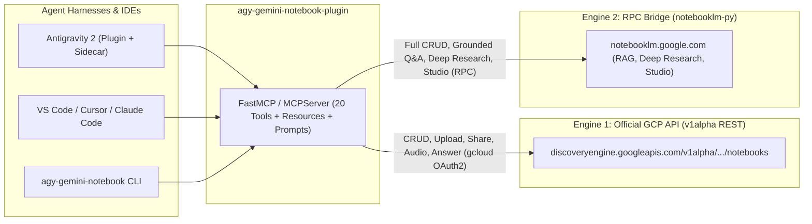

# 📓 agy-gemini-notebook-plugin

**Invoke and pilot Gemini Notebooks (NotebookLM & NotebookLM Enterprise) from Google Antigravity 2, VS Code, Cursor, Claude Code, and the CLI.**

In the Gemini web app, users can attach a **Gemini Notebook (NotebookLM)** to a conversation for grounded, source-backed context. **`agy-gemini-notebook-plugin`** brings first-class Gemini Notebook integration—plus **autonomous notebook piloting, Fast & Deep Research, and Studio Artifact generation**—directly into **Google Antigravity 2**, **VS Code**, and any MCP-compatible agent harness.

---

## ✨ Key Features

- 🎯 **Invoke Notebooks by ID, Alias, or Fuzzy Title (`notebook_invoke` & `notebook_query`)**:
  - Attach a default notebook (plus named aliases) to your repository via `.agents/notebook.json`.
  - Invoke any notebook on the fly by ID, workspace alias, or fuzzy title match—with optional one-step grounded Q&A and inline source citations.
- 🔬 **Autonomous Fast & Deep Research (`notebook_research`)**:
  - Pilot NotebookLM's **Fast Research** (`mode="fast"`), **Deep Research** (`mode="deep"`), and **Source Discovery** (`mode="discover"`) across the **Web** or **Google Drive**, and automatically import verified sources into your notebook.
- 🏢 **Engine 1 — Official Google Cloud API (`v1alpha` Discovery Engine)**:
  - 100% official OAuth 2.0 authentication via `gcloud auth print-access-token` (no browser cookies required).
  - Create/get/delete/share notebooks, upload local files (`sources:uploadFile`), ingest URLs/YouTube/Drive (`sources:batchCreate`), generate Audio Overviews, and run Enterprise Grounded Q&A (`servingConfigs:answer`).
- 💬 **Engine 2 — Full RPC Bridge (`notebooklm-py` for Consumer & Enterprise)**:
  - Automatic Dual-Engine fallback when `GCP_PROJECT_NUMBER` is not set—giving personal Google accounts (`notebooklm.google.com`) full CRUD, file uploads, source search, grounded Q&A with inline citations, Deep Research, Notes, and Studio Artifacts (Audio Overviews, Briefing Docs, Study Guides, Mind Maps, Quizzes, Flashcards, Slide Decks).
- 🖥️ **Multi-Environment Ready (Antigravity 2 + VS Code + Cursor + CLI)**:
  - **Antigravity 2 Plugin**: Native MCP Server + Skill + Grounding Rule + Auxiliary Pane Sidecar UI.
  - **VS Code / Cursor / Claude Code**: Portable `scripts/run_mcp.sh` wrapper + MCP Resources (`notebook://active`) & Prompts (`invoke_notebook`, `deep_research_notebook`) + `--transport stdio|sse|streamable-http`.
  - **Standalone CLI (`agy-gemini-notebook`)**: Invoke, query, sync files, and launch Deep Research from any terminal or agent bash tool.

---

## 🏗️ Dual-Engine Architecture



---

## 🚀 Quick Start

### 1. Clone and install dependencies

```bash
git clone https://github.com/Chryzalide/agy-gemini-notebook-plugin.git
cd agy-gemini-notebook-plugin
uv sync --all-extras
```

### 2. Configure Authentication

#### Option A: Personal Google Account (`notebooklm.google.com` — Engine 2)
Authenticate your `notebooklm-py` session once:

```bash
.venv/bin/notebooklm login
```

#### Option B: NotebookLM Enterprise (Official Google Cloud `v1alpha` API — Engine 1)
Set your Google Cloud environment variables and authenticate via `gcloud`:

```bash
export GCP_PROJECT_NUMBER="123456789012"
export GCP_LOCATION="global"          # global, us, or eu
export GCP_ENDPOINT_LOCATION="global" # global, us, or eu

gcloud auth login
```

---

## 🔌 IDE & Agent Harness Setup

### Google Antigravity 2
Symlink the repository into your Antigravity 2 plugins directory:

```bash
mkdir -p ~/.gemini/config/plugins
ln -s /path/to/agy-gemini-notebook-plugin ~/.gemini/config/plugins/gemini-notebook
```

### VS Code (GitHub Copilot MCP / Cline / Roo Code) & Cursor
Add the server to your workspace `.vscode/mcp.json` (or `.cursor/mcp.json`):

```json
{
  "servers": {
    "gemini_notebook_mcp": {
      "type": "stdio",
      "command": "/path/to/agy-gemini-notebook-plugin/scripts/run_mcp.sh",
      "env": {
        "AGY_WORKSPACE_DIR": "${workspaceFolder}"
      }
    }
  }
}
```

### Standalone CLI (`agy-gemini-notebook`)
Use the CLI from any terminal or agent shell tool:

```bash
# Check engine auth and active workspace binding
agy-gemini-notebook status

# Invoke a notebook by fuzzy title or alias and ask a grounded question
agy-gemini-notebook invoke "System Architecture" -q "What are the latency SLAs?"

# Create a notebook and run autonomous Deep Research with source auto-import
agy-gemini-notebook create "WebGPU Compute Patterns" --attach --alias webgpu
agy-gemini-notebook research "WebGPU subgroup operations performance" --mode deep

# Sync local markdown/PDF specs into the active notebook
agy-gemini-notebook sync README.md docs/architecture.md
```

---

## 🛠️ Exposed MCP Tools (`gemini_notebook_mcp`)

| Category | MCP Tool | Engine | Description |
| :--- | :--- | :--- | :--- |
| **Workspace & Invocation** | `notebook_status` | Local + Dual | Show active `.agents/notebook.json` binding and engine auth readiness |
| | `notebook_attach` | Local | Attach a default notebook (or register an `--alias`) to the workspace |
| | `notebook_invoke` | Dual | Resolve a notebook by ID, alias, or fuzzy title, inspect sources, and optionally run a grounded query |
| **Notebook CRUD & Sharing** | `notebook_list` | Dual | List notebooks (`v1alpha` recently viewed or RPC full list) |
| | `notebook_get` | Dual | Retrieve notebook metadata and normalized source list |
| | `notebook_create` | Dual | Create a new Gemini Notebook (and optionally bind it to the workspace) |
| | `notebook_delete` | Dual | Delete one or more notebooks |
| | `notebook_rename` | Engine 2 (RPC) | Rename an existing notebook |
| | `notebook_share` | Dual | Share a notebook with users or toggle public link sharing |
| **Sources & Code Sync** | `notebook_sync_files` | Dual | Upload local workspace files (`.md`, `.pdf`, `.txt`, `.docx`, etc.) into a notebook |
| | `notebook_add_source` | Dual | Ingest a web URL, raw text, YouTube video, or Google Drive document |
| | `notebook_delete_sources` | Dual | Delete specific sources from a notebook |
| | `notebook_search_sources` | Engine 2 (RPC) | Keyword/semantic search across sources inside a notebook |
| | `notebook_get_source_text` | Engine 2 (RPC) | Extract the full indexed plain text of a specific source |
| **Grounded Q&A & Research** | `notebook_query` | Dual | Ask a grounded RAG question with inline citations (and optionally save as a note) |
| | `notebook_research` | Engine 2 (RPC) | Launch **Fast Research** (`fast`), **Deep Research** (`deep`), or **Source Discovery** (`discover`) on Web or Drive |
| | `notebook_research_status` | Engine 2 (RPC) | Poll or cancel an asynchronous research task and auto-import discovered sources |
| **Studio Artifacts & Notes** | `notebook_create_audio` | Dual | Generate a podcast **Audio Overview** |
| | `notebook_generate_artifact` | Engine 2 (RPC) | Generate a Briefing Doc, Study Guide, Mind Map, Quiz, Flashcards, or Slide Deck |
| | `notebook_notes` | Engine 2 (RPC) | List, create, update, or delete persistent notes inside a notebook |

---

## 📄 License

Distributed under the **MIT License**. Contributions are welcome!
